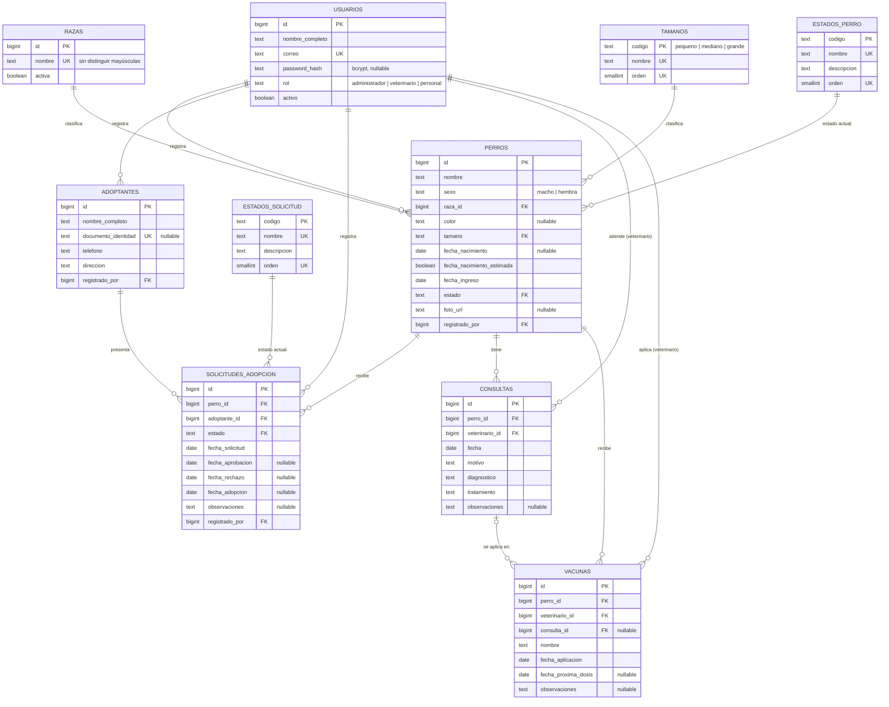
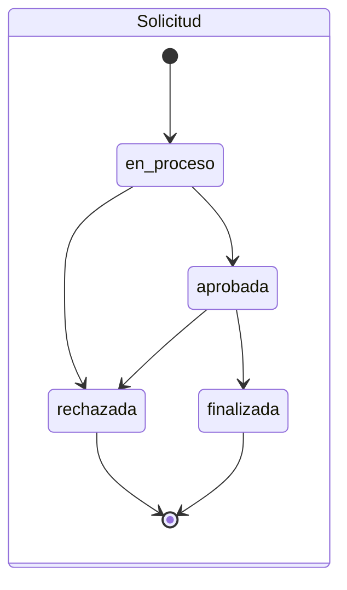

# Modelo de datos — HU-01

> **Estado: propuesta para revisión del equipo.** El modelo todavía **no está aprobado**.
> Hay decisiones ya confirmadas y otras propuestas pendientes de confirmar (sección 4).

Fuentes revisadas: mockup del frontend (`frontend/src/App.tsx`), `README.md`, `docs/arquitectura.md`,
`backend/README.md`, `database/README.md` y `.env.example`. No había tablas, migraciones ni
autenticación implementada: el login del mockup acepta cualquier dato.

Leyenda usada en este documento:

| Marca | Significado |
|-------|-------------|
| **[M]** | Dato observado en el mockup |
| **[HU]** | Requisito explícito de la HU-01 |
| **[C]** | Decisión confirmada por el responsable del proyecto |
| **[P]** | Propuesta técnica: pendiente de que el equipo la confirme |

---

## 1. Procesos y datos identificados

| Proceso (mockup) | Qué hace | Datos que necesita |
|------------------|----------|--------------------|
| Iniciar sesión | Usuario y contraseña; el menú muestra nombre y cargo | Correo, contraseña (hash), nombre, rol |
| Dashboard | Totales por estado y lista de perros en tratamiento | Estado del perro, raza, sexo, foto, fecha de ingreso |
| Listado de perros | Buscar por nombre o raza, filtrar por estado | Nombre, raza, estado, foto, sexo, edad, tamaño |
| Registrar / editar perro | Ficha del perro | Nombre, raza, sexo, fecha de nacimiento (opcional), color (opcional), tamaño, fecha de ingreso, estado, URL de foto |
| Detalle del perro | Pestañas: información, historial médico, adopción | Todo lo anterior + consultas + solicitud del perro |
| Registrar atención médica | Consulta de un perro | Fecha, veterinario responsable, motivo, diagnóstico, tratamiento, observaciones |
| Registrar adopción | Perro disponible + datos del adoptante | Perro, nombre, teléfono y dirección del adoptante, fecha, estado, observaciones |
| Detalle de adopción | Ver y cambiar el estado del proceso | Estado de la solicitud y su efecto en el estado del perro |

Reglas que el mockup ya aplica: solo se puede iniciar una adopción si el perro está *Disponible*.
Al iniciarla, el perro pasa a *En proceso de adopción*. Si se finaliza, queda *Adoptado*. Si se
rechaza, vuelve a *Disponible*.

## 2. Correspondencia pantalla → datos → tablas

| Pantalla / proceso | Datos | Tabla.campo |
|--------------------|-------|-------------|
| Login | usuario, contraseña **[M]** | `usuarios.correo`, `usuarios.password_hash` |
| Menú lateral | nombre, "Personal del albergue" **[M]** | `usuarios.nombre_completo`, `usuarios.rol` |
| Ficha del perro | nombre, sexo, color **[M]** | `perros.nombre`, `sexo`, `color` |
| Ficha del perro | raza, tamaño (listas) **[M]** | `perros.raza_id` → `razas`, `perros.tamano` → `tamanos` **[C]** |
| Ficha del perro | fecha de nacimiento **[M]**, edad **[M]** (calculada) | `perros.fecha_nacimiento`, `fecha_nacimiento_estimada` **[P]** → `v_perros.edad_meses` |
| Ficha del perro | fecha de ingreso, estado **[M]** | `perros.fecha_ingreso`, `perros.estado` → `estados_perro` |
| Ficha del perro | URL de la foto **[M]** | `perros.foto_url` |
| Filtros del listado | búsqueda por nombre/raza, filtro por estado **[M]** | `perros.nombre`, `perros.raza_id`, índices `ix_perros_estado` e `ix_perros_raza` |
| Atención médica | fecha, motivo, diagnóstico, tratamiento, observaciones **[M]** | `consultas.*` |
| Atención médica | veterinario responsable **[M]** (texto libre en el mockup) | `consultas.veterinario_id` → `usuarios` **[P]** |
| Vacunas | no aparecen en el mockup; las pide la HU **[HU]** | `vacunas.*` |
| Adopción | datos del adoptante **[M]** | `adoptantes.nombre_completo`, `telefono`, `direccion` |
| Adopción | perro, fecha, estado, observaciones **[M]** | `solicitudes_adopcion.perro_id`, `fecha_solicitud`, `estado`, `observaciones` |
| Adopción | fechas de cada etapa **[P]** | `solicitudes_adopcion.fecha_aprobacion`, `fecha_rechazo`, `fecha_adopcion` |
| Dashboard | conteos por estado **[M]** | se calculan con `count(*)` sobre `perros.estado` |
| Trazabilidad | quién registró cada dato **[P]** | `registrado_por` en perros, adoptantes y solicitudes; `veterinario_id` en consultas y vacunas |

## 3. Vacíos e inconsistencias encontrados

1. **Estados del perro.** El mockup usa 4 estados; la documentación usaba `en_evaluacion` y un campo
   `apto_adopcion`. → **[C]** Se usan los 4 del mockup y se elimina `apto_adopcion`.
2. **Adoptante sin entidad propia.** En el mockup, nombre, teléfono y dirección van dentro de la
   adopción. → La HU pide una tabla `adoptantes` **[HU]**, así que una persona puede tener varias solicitudes.
3. **Veterinario como texto libre.** El mockup escribe "Dr. Andrés Ramírez" a mano. → **[P]** Se
   referencia un usuario con rol `veterinario`, para evitar nombres escritos de distintas formas.
4. **Vacunas.** La HU las exige y el dashboard previsto muestra "vacunas próximas", pero el mockup no
   tiene pantalla de vacunas. → Tabla `vacunas` **[HU]**, con un formulario que falta diseñar.
5. **Tratamientos.** La documentación preveía una tabla `tratamientos`; en el mockup el tratamiento es
   un campo de texto de la consulta. → **[P]** Se guarda como texto en `consultas.tratamiento`.
6. **El estado del perro se elige a mano** en el formulario del mockup, incluso "Adoptado". → **[P]**
   La base solo permite cambiar a mano entre `disponible` y `en_tratamiento`. `en_adopcion` y
   `adoptado` los asigna la solicitud.
7. **"Fecha de adopción" ambigua.** Al crear el proceso, el mockup pide "fecha de adopción" con estado
   *En proceso*. → **[P]** Se interpreta como `fecha_solicitud`. La fecha de entrega real es `fecha_adopcion`.
8. **El mockup permite cualquier cambio de estado de la solicitud** (por ejemplo, reabrir una
   rechazada). → **[P]** Solo se permiten las transiciones del apartado "Estados" (sección 5).
9. **La documentación decía que al aprobar el perro queda `adoptado`.** El mockup distingue *Aprobada*
   de *Finalizada*. → **[P]** Se sigue el mockup: el perro queda adoptado al **finalizar**.
10. **Documentación desactualizada** (no modificada en esta HU): `docs/arquitectura.md` y
    `backend/README.md` siguen hablando de `animales`, `apto_adopcion`, `en_evaluacion`, `tratamientos`
    y de "aprobar → adoptado". `.env.example` todavía tiene variables de un PostgreSQL local.

## 4. Decisiones

### Confirmadas [C]

| # | Decisión |
|---|----------|
| C1 | Autenticación propia: tabla `usuarios` con `password_hash` bcrypt; el backend valida el login. **No** se usa Supabase Auth. |
| C2 | Roles: `administrador`, `veterinario`, `personal`. |
| C3 | Un perro tiene como máximo **una solicitud activa** (`en_proceso` o `aprobada`). |
| C4 | Estados del perro: `disponible`, `en_tratamiento`, `en_adopcion`, `adoptado`. |
| C5 | La base vive en Supabase y solo accede el backend. El frontend no se conecta a la base. |
| C6 | Catálogos para **razas**, **tamaños**, **estados del perro** y **estados de la solicitud**. Sexo queda como `CHECK` (dos valores fijos). |
| C7 | Índice en todas las claves foráneas que se usan para consultar (`registrado_por`, `veterinario_id`, `perro_id`, `raza_id`, `tamano`). |

### Propuestas pendientes de confirmar [P]

| # | Propuesta | Alternativa si no se acepta |
|---|-----------|-----------------------------|
| P1 | Solicitud y adopción son **el mismo registro** en distintas etapas | Tabla `adopciones` separada creada al aprobar |
| P2 | Transiciones: `en_proceso → aprobada/rechazada`, `aprobada → finalizada/rechazada`. Las solicitudes rechazadas y finalizadas no cambian más | Permitir reabrir |
| P3 | **Sin devoluciones**: un perro adoptado no vuelve al albergue en el sistema | Agregar estado `devuelta` y permitir una nueva adopción |
| P4 | **No se borra nada** que tenga historial (las claves foráneas usan `RESTRICT`). Los usuarios se desactivan con `activo = false` | Borrado lógico (`eliminado_en`) en perros y adoptantes |
| P5 | Un perro con solicitud activa **no puede pasar a `en_tratamiento`**: primero hay que rechazar la solicitud | Separar `estado_salud` y `estado_adopcion` en dos columnas, para que un perro pueda estar en tratamiento con una adopción en curso |
| P6 | El veterinario responsable es un **usuario del sistema** | Campo de texto para veterinarios externos |
| P7 | Edad: `fecha_nacimiento` + `fecha_nacimiento_estimada` | Guardar `edad_aproximada_meses` |
| P8 | `adoptantes.documento_identidad` opcional y único, para no duplicar personas | No guardar documento |
| P9 | El tratamiento es texto en la consulta; no hay tabla `tratamientos` | Tabla `tratamientos` con fechas de inicio y fin |
| P10 | Las reglas de estado se validan **en la base de datos** (triggers), no solo en el backend | Validar solo en el backend |
| P11 | Trazabilidad: `registrado_por`, `creado_en`, `actualizado_en` y fechas por etapa. No hay tabla de historial de cambios | Tabla `historial_estados` |
| P12 | Una sola foto por perro (`foto_url`) | Tabla `fotos_perro` (varias fotos) |

### Preguntas abiertas

1. ¿Quién puede crear, aprobar o rechazar solicitudes y registrar consultas? (permisos por rol;
   los aplicaría el backend, no la base).
2. ¿Las vacunas necesitan más datos, como lote, laboratorio o un catálogo de vacunas?
3. ¿El adoptante necesita correo u otros datos de contacto además de los del mockup?
4. ¿Hace falta registrar *quién* aprobó o rechazó una solicitud, además de quién la creó?

## 5. Modelo entidad-relación

Cardinalidades clave:

- Un perro tiene 0..N solicitudes, pero como máximo **1 activa** y **1 finalizada** (índices únicos parciales).
- Un adoptante tiene 0..N solicitudes.
- Un perro tiene 0..N consultas y 0..N vacunas. Una vacuna pertenece como máximo a 1 consulta, **del mismo perro**.
- Las tablas principales tienen además `creado_en` y `actualizado_en` (`timestamptz`). No se muestran en el diagrama.
- Los catálogos (razas, tamaños, estados) se relacionan 1..N con perros y solicitudes.

### Estados

| Evento | Estado de la solicitud | Estado del perro (automático) |
|--------|------------------------|-------------------------------|
| Se crea la solicitud (el perro debe estar `disponible`) | `en_proceso` | `en_adopcion` |
| Se aprueba | `aprobada` | `en_adopcion` |
| Se entrega el perro | `finalizada` | `adoptado` |
| Se rechaza | `rechazada` | `disponible` |
| Cambio manual (veterinaria o personal) | — | solo `disponible` ↔ `en_tratamiento`, y solo si no hay solicitud activa ni finalizada |

## 6. Diccionario de datos

Convenciones: todos los `id` son `bigint generated always as identity`. Los textos obligatorios no
pueden estar vacíos ni ser solo espacios. Las listas de valores son **tablas catálogo**; solo `sexo`
y `rol` siguen como `text` + `CHECK`.

### Catálogos

| Tabla | Clave | Campos | Valores iniciales |
|-------|-------|--------|-------------------|
| tamanos | `codigo` text | `nombre` (único), `orden` (único) | pequeno, mediano, grande |
| estados_perro | `codigo` text | `nombre` (único), `descripcion`, `orden` (único) | disponible, en_tratamiento, en_adopcion, adoptado |
| estados_solicitud | `codigo` text | `nombre` (único), `descripcion`, `orden` (único) | en_proceso, aprobada, rechazada, finalizada |
| razas | `id` bigint | `nombre` (único sin distinguir mayúsculas, sin espacios sobrantes), `activa`, `creado_en` | 20 razas comunes + Mestizo |

Los códigos solo admiten minúsculas y `_`. Un valor en uso no se puede borrar (FK).

### usuarios

| Campo | Tipo | Oblig. | Restricciones |
|-------|------|:------:|---------------|
| id | bigint | Sí | PK |
| nombre_completo | text | Sí | no vacío |
| correo | text | Sí | UNIQUE; en minúsculas; formato de correo |
| password_hash | text | No | solo un hash bcrypt de 60 caracteres. NULL = no puede iniciar sesión |
| rol | text | Sí | `administrador`, `veterinario`, `personal` |
| activo | boolean | Sí | por defecto `true` |
| creado_en / actualizado_en | timestamptz | Sí | `now()`; `actualizado_en` lo mantiene un trigger |

### perros

| Campo | Tipo | Oblig. | Restricciones |
|-------|------|:------:|---------------|
| id | bigint | Sí | PK |
| nombre | text | Sí | no vacío |
| sexo | text | Sí | `macho`, `hembra` |
| raza_id | bigint | Sí | FK → razas (para cruces: "Mestizo") |
| color | text | No | |
| tamano | text | Sí | FK → tamanos |
| fecha_nacimiento | date | No | ≤ `fecha_ingreso` |
| fecha_nacimiento_estimada | boolean | Sí | `false` por defecto; solo `true` si hay fecha |
| fecha_ingreso | date | Sí | hoy por defecto |
| estado | text | Sí | FK → estados_perro; `disponible` por defecto; coherencia validada por trigger |
| foto_url | text | No | empieza por `http://` o `https://` |
| registrado_por | bigint | Sí | FK → usuarios |
| creado_en / actualizado_en | timestamptz | Sí | |

Índices: `ix_perros_estado`, `ix_perros_raza`, `ix_perros_tamano`, `ix_perros_registrado_por`.

### adoptantes

| Campo | Tipo | Oblig. | Restricciones |
|-------|------|:------:|---------------|
| id | bigint | Sí | PK |
| nombre_completo | text | Sí | no vacío |
| documento_identidad | text | No | UNIQUE **[P8]** |
| telefono | text | Sí | 7 a 15 dígitos, `+` inicial opcional |
| direccion | text | Sí | no vacío |
| registrado_por | bigint | Sí | FK → usuarios |
| creado_en / actualizado_en | timestamptz | Sí | |

### solicitudes_adopcion

| Campo | Tipo | Oblig. | Restricciones |
|-------|------|:------:|---------------|
| id | bigint | Sí | PK |
| perro_id | bigint | Sí | FK → perros; no se puede cambiar después |
| adoptante_id | bigint | Sí | FK → adoptantes; no se puede cambiar después |
| estado | text | Sí | FK → estados_solicitud; `en_proceso` por defecto |
| fecha_solicitud | date | Sí | hoy por defecto |
| fecha_aprobacion | date | Según estado | obligatoria en `aprobada` y `finalizada`; ≥ `fecha_solicitud` |
| fecha_rechazo | date | Según estado | obligatoria solo en `rechazada` |
| fecha_adopcion | date | Según estado | obligatoria solo en `finalizada`; ≥ `fecha_aprobacion` |
| observaciones | text | No | |
| registrado_por | bigint | Sí | FK → usuarios |
| creado_en / actualizado_en | timestamptz | Sí | |

Índices: `uq_solicitudes_activa_por_perro` (único parcial, estados activos),
`uq_solicitudes_finalizada_por_perro` (único parcial), `ix_solicitudes_perro (perro_id, fecha_solicitud desc)`,
`ix_solicitudes_adoptante`, `ix_solicitudes_estado`, `ix_solicitudes_registrado_por`.

### consultas

| Campo | Tipo | Oblig. | Restricciones |
|-------|------|:------:|---------------|
| id | bigint | Sí | PK; UNIQUE (`id`, `perro_id`) para la FK de vacunas |
| perro_id | bigint | Sí | FK → perros |
| veterinario_id | bigint | Sí | FK → usuarios; debe tener rol `veterinario` y estar activo (trigger) |
| fecha | date | Sí | hoy por defecto |
| motivo / diagnostico / tratamiento | text | Sí | no vacíos |
| observaciones | text | No | |
| creado_en / actualizado_en | timestamptz | Sí | |

Índices: `ix_consultas_perro_fecha (perro_id, fecha desc)`, `ix_consultas_veterinario`.

### vacunas

| Campo | Tipo | Oblig. | Restricciones |
|-------|------|:------:|---------------|
| id | bigint | Sí | PK |
| perro_id | bigint | Sí | FK → perros |
| veterinario_id | bigint | Sí | FK → usuarios; rol `veterinario` y activo (trigger) |
| consulta_id | bigint | No | FK compuesta (`consulta_id`, `perro_id`) → consultas: debe ser del mismo perro |
| nombre | text | Sí | no vacío |
| fecha_aplicacion | date | Sí | hoy por defecto |
| fecha_proxima_dosis | date | No | > `fecha_aplicacion` |
| observaciones | text | No | |
| creado_en / actualizado_en | timestamptz | Sí | |

Índices: `ix_vacunas_perro_fecha`, `ix_vacunas_proxima_dosis` (parcial), `ix_vacunas_consulta` (parcial), `ix_vacunas_veterinario`.

### Datos calculados (no se guardan)

| Dato | Dónde |
|------|-------|
| Edad del perro | `fn_edad_en_meses(fecha_nacimiento)` y vista `v_perros.edad_meses` (NULL si no se conoce) |
| Totales por estado (dashboard) | `count(*)` agrupando `perros.estado` |
| Historial médico | consultas + vacunas del perro, ordenadas por fecha |
| Solicitud actual del perro | la solicitud con estado `en_proceso`/`aprobada`, o la `finalizada` |

## 7. Justificación de las decisiones

- **Una tabla por entidad real, no por pantalla.** El adoptante se separa de la solicitud porque una
  persona puede postular más de una vez. El historial médico no es una tabla: es la unión de consultas y vacunas.
- **Solicitud = adopción (P1).** El mockup las trata como un único proceso con estados. Separarlas
  duplicaría el perro, el adoptante y las fechas.
- **El estado del perro se guarda, pero lo controla la base (P10).** Guardarlo simplifica los filtros y
  el dashboard. Los triggers garantizan que nunca contradiga sus solicitudes, aunque escriban dos
  servicios distintos (Adopción y Veterinaria).
- **Fechas por etapa en lugar de una tabla de historial (P11).** Dan trazabilidad suficiente para el
  alcance académico sin agregar otra entidad.
- **Edad (P7).** Guardar la edad envejece mal: hoy "2 años" deja de ser cierto el año siguiente. Una
  fecha estimada con una marca permite calcular la edad siempre y saber que es aproximada.
- **Foto como URL.** La imagen vive en Supabase Storage (u otro servicio) y la tabla solo guarda la referencia.
- **Catálogos (C6).** Razas, tamaños y estados son tablas: se evita escribir "Labrador" de tres formas,
  agregar un valor es un `INSERT` y el nombre visible se cambia sin tocar los datos. Los estados usan un
  código de texto como clave porque las reglas de adopción y la API se refieren a ellos por nombre.
- **Normalización.** Todas las tablas están en 3FN: cada dato depende solo de la clave de su tabla. La única
  redundancia es `perros.estado`, que se podría deducir de las solicitudes. Se conserva por rendimiento y los
  triggers impiden que se contradiga.
- **Escalabilidad (C7).** Claves `bigint`, índices en las claves foráneas y en los filtros del listado, e índices
  parciales para las consultas frecuentes (solicitud activa, vacunas próximas).
- **Sin borrado físico (P4).** Las claves foráneas con `RESTRICT` protegen el historial médico y de adopciones.
- **Contraseñas.** Solo se acepta un hash bcrypt. Los datos de prueba no incluyen contraseñas.
- **Permisos.** RLS activado y sin políticas, y se revocan los privilegios de `anon` y `authenticated`.
  La API pública de Supabase no puede leer ni escribir nada. El backend se conecta como dueño de las tablas.
